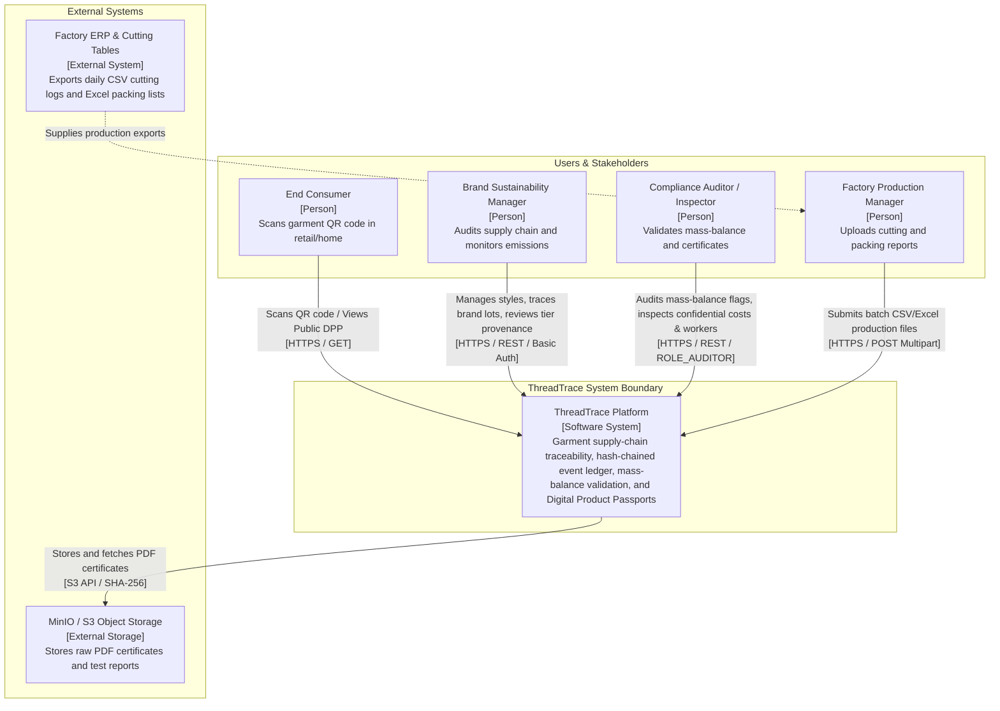
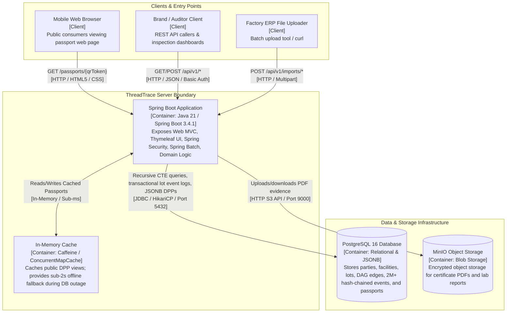
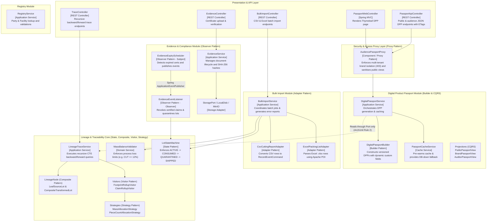

# ThreadTrace — C4 Architecture Documentation

This document describes the architecture of the **ThreadTrace** Garment Supply-Chain Traceability and Digital Product Passport (DPP) platform using the C4 model (Context, Container, and Component levels).

---

## 1. C4 Level 1: System Context Diagram

The Context diagram illustrates how ThreadTrace interacts with external actors (consumers, brands, compliance auditors, factory operators) and third-party systems.

---

## 2. C4 Level 2: Container Diagram

The Container diagram zooms into ThreadTrace, showing its high-level technical runtime blocks, communication protocols, and data persistence boundaries.

---

## 3. C4 Level 3: Component Diagram

The Component diagram reveals the internal modular decomposition of the Spring Boot application, showing how GoF patterns and domain boundaries collaborate while respecting strict ArchUnit rules.

